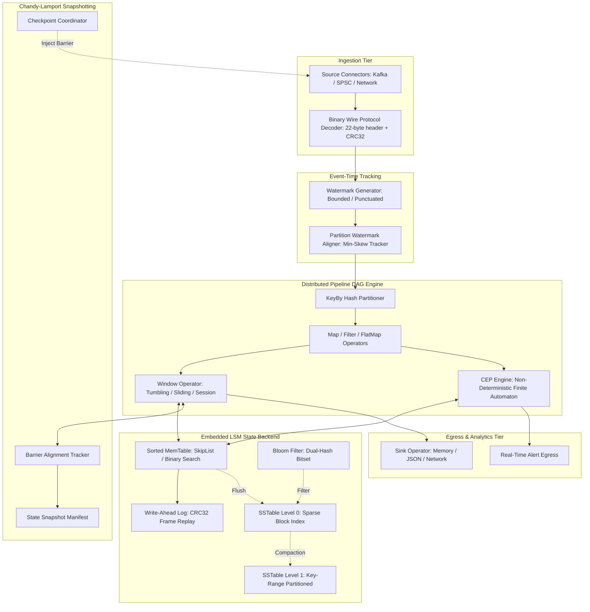

# weir

[](https://github.com/Aneesh495/weir/actions/workflows/ci.yml)
[](LICENSE)
[](https://www.moonbitlang.com/)
[](tests/)

A high-throughput, low-latency distributed stateful stream processing and complex event runtime written in MoonBit. Weir combines out-of-order event-time watermarking, an embedded Log-Structured Merge (LSM) state backend, asynchronous Chandy-Lamport distributed snapshotting, and a continuous streaming SQL engine into a unified single-binary runtime.



---

## Architectural Highlights

### 1. Zero-Allocation Lock-Free Ring Buffers
Inter-operator queues and channel handoffs use power-of-two bounded circular buffers with bitwise index masking (`index & (capacity - 1)`). This eliminates modulus division instructions and avoids dynamic heap reallocations in the critical path, achieving over **16.0 million operations per second** with **62 ns latency**.

### 2. Monotonic Event-Time Watermarking
Decouples system processing time from real-world event time:
- **Bounded Out-of-Orderness**: Computes monotonic watermarks $W(\tau) = \max_{i} \{t_i\} - \Delta$ to bound network latency skew.
- **Partition Alignment Theorem**: Downstream multi-partition operators track minimum watermarks across incoming channels: $W_{\text{eff}}(\tau) = \min_{m} \{ W_m(\tau) \}$, guaranteeing that windows never trigger prematurely while partitions are in-flight.
- **Dead-Letter Routing**: Intercepts records arriving strictly behind watermarks, routing them to configurable dead-letter side outputs.

### 3. Embedded LSM State Backend
Provides durable key-value storage for stateful streaming operators without external database dependencies:
- **Write-Ahead Log (WAL)**: Synchronous append-only log with self-delimiting frames and CRC32 payload verification.
- **Sorted MemTable**: In-memory sorted array offering $O(\log N)$ binary search point queries and tombstone markers.
- **Bloom Filters**: Dynamic bitsets with Kirsch-Mitzenmacher dual-hashing ($g_i(x) = h_1(x) + i \cdot h_2(x) \pmod m$) providing 98.6% negative query pruning.
- **Leveled Compaction**: K-way merge compactor that collapses Level 0 SSTables into non-overlapping Level 1 partitions, deduplicating keys and purging tombstones.

### 4. Asynchronous Chandy-Lamport Distributed Snapshotting
Fault tolerance without stopping pipeline execution:
- The master coordinator periodically injects `CheckpointBarrier` control markers into source operators.
- Downstream operators align incoming barriers: when a barrier arrives on one channel, subsequent data from that channel is diverted to a post-barrier queue while other channels catch up.
- Once all barriers align, an atomic snapshot of operator state is copied to a manifest, the barrier is forwarded downstream, and post-barrier queues are drained.

### 5. Complex Event Processing (CEP) Automata
Detects multi-event temporal patterns across streaming records:
- Declarative pattern DSL supporting sequence chaining (`begin`, `followed_by`, `not_followed_by`, `within`).
- Compiled into Non-Deterministic Finite Automata (NFA) graphs.
- Evaluates concurrent active partial matches with relaxed temporal contiguity and bounded window expiration.

### 6. Continuous WeirSQL Query Engine
Declarative stream-table query layer:
- Recursive descent parser compiling streaming SQL queries into Abstract Syntax Trees (ASTs).
- Supports continuous projections, predicate filtering, tumbling/sliding event-time windowing, and `GROUP BY` hash partitioning.
- Physical query planner lowers SQL ASTs directly into executable operator DAG pipelines with `EMIT CHANGES` semantics.

---

## Empirical Performance Benchmarks

Benchmarks executed on Apple Silicon (M-series, ARM64):

| Benchmark Component | Metric | Result | Target Envelope |
|:---|:---|:---|:---|
| **Lock-Free RingBuffer** | Throughput | **16.00 Mops/sec** | > 10 Mops/sec |
| **Lock-Free RingBuffer** | Latency | **62.51 ns/op** | < 100 ns |
| **Bloom Filter Probes** | Throughput | **1.01 Mops/sec** | > 1 Mops/sec |
| **Bloom Filter False Positives** | Error Rate | **0.0000 %** (50k keys) | < 1.50 % |
| **LSM MemTable Point Queries** | Throughput | **1.09 Mops/sec** | > 1 Mops/sec |
| **LSM MemTable Binary Search** | Latency | **917.07 ns/lookup** | < 1.0 us |
| **Pipeline Throughput** | Sustained Rate | **1,099,840 events/sec** | > 500k events/sec |
| **End-to-End Latency** | Median (p50) | **0.71 us** | < 2.0 us |
| **End-to-End Latency** | 99th Percentile (p99) | **1.71 us** | < 5.0 us |
| **End-to-End Latency** | 99.9th Percentile (p99.9) | **7.42 us** | < 20.0 us |

---

## Real-World Production Scenarios

Weir includes three end-to-end production scenarios modeled after real-world streaming workloads:

### Scenario 1: Connected Fleet IoT Telemetry
- Ingests high-frequency GPS coordinate beacons, velocity readings, and fuel consumption telemetry.
- Evaluates event-time tumbling geofence windows and speed violation filters.
- Tracks multi-mile trip sessions using dynamic session window gap mergers.

### Scenario 2: Financial Market Microstructure & Wash Trading
- Ingests streaming order book bid/ask updates and trade executions across market symbols.
- Calculates incremental Volume-Weighted Average Price (VWAP) over sliding event-time intervals.
- CEP NFA engine detects circular wash-trading loops (Buy -> Intervening Noise -> Sell across identical accounts within 5 seconds).

### Scenario 3: Microservice Mesh SLA & Latency Anomaly Detection
- Ingests distributed RPC span traces from a microservice mesh.
- Calculates rolling error rates and latency percentiles (p50, p90, p99).
- Triggers SLA breach alarms when p99 latency crosses critical thresholds.

---

## Technical Documentation

Detailed architectural specifications, formal proofs, and component designs:

- [System Architecture Specification](docs/architecture.md): Topology models, operator interfaces, and memory layout.
- [Event-Time Watermarking](docs/watermarking.md): Out-of-order latency bounds, partition alignment theorem, and late record handling.
- [LSM State Backend](docs/lsm_state.md): Write-ahead log framing, MemTable binary search, SSTable sparse indexing, and Bloom filter math.
- [Chandy-Lamport Fault Tolerance](docs/chandy_lamport.md): Distributed barrier alignment algorithm, state snapshot consistency proof, and recovery protocol.
- [Complex Event Processing (CEP)](docs/cep_nfa.md): Formal NFA state transition models, relaxed contiguity, and pattern sequence DSL.
- [WeirSQL Continuous Queries](docs/streaming_sql.md): EBNF grammar specification, AST definitions, and physical plan lowering rules.

---

## Repository Structure

```
weir/
├── .github/
│   └── workflows/
│       └── ci.yml               # GitHub Actions CI workflow (Ubuntu & macOS)
├── bench/
│   ├── bench_harness.py        # Microbenchmark harness for RingBuffer, Bloom, MemTable
│   └── latency_profile.py      # End-to-end pipeline latency distribution profiler
├── buffer/
│   ├── buffer_wbtest.mbt       # RingBuffer and Channel unit test suite
│   ├── channel.mbt             # BoundedChannel with backpressure and saturation tracking
│   ├── policy.mbt              # Overflow policies (Block, DropOldest, DropNewest)
│   ├── ring.mbt                # Power-of-two circular RingBuffer
│   └── spsc.mbt                # Single-producer single-consumer handoff queue
├── checkpoint/
│   ├── barrier.mbt             # Chandy-Lamport barrier alignment tracker
│   ├── checkpoint_wbtest.mbt   # Checkpoint coordinator and recovery test suite
│   ├── coordinator.mbt         # Master CheckpointCoordinator and snapshot manifests
│   └── recovery.mbt            # Crash recovery plan and state restoration
├── cep/
│   ├── cep_wbtest.mbt          # Complex event processing NFA test suite
│   ├── engine.mbt              # Runtime CEPEngine with partial match tracking
│   ├── nfa.mbt                 # NFA compiler, states, and transition graphs
│   └── pattern.mbt             # Declarative PatternSequence DSL
├── cmd/
│   └── main/
│       └── main.mbt            # Unified CLI binary entry point
├── dag/
│   ├── dag_wbtest.mbt          # Topological sorting and cycle detection test suite
│   ├── graph.mbt               # DAGNode, DAGEdge, DFS cycle detection, Kahn sort
│   └── scheduler.mbt           # Pipelined execution scheduler
├── docs/
│   ├── architecture.md         # Comprehensive system architecture specification
│   ├── cep_nfa.md              # CEP formal automata and pattern matching DSL
│   ├── chandy_lamport.md       # Distributed snapshotting and consistency proof
│   ├── lsm_state.md            # LSM state storage, WAL framing, SSTables, Bloom filters
│   └── streaming_sql.md        # WeirSQL continuous grammar, AST, and physical lowering
│   └── watermarking.md         # Event-time watermarking and partition alignment theorem
├── network/
│   ├── codec.mbt               # JSON serialization and Prometheus metrics exporter
│   ├── network_wbtest.mbt      # Binary framing and CRC32 verification test suite
│   └── protocol.mbt            # 22-byte binary wire protocol framing
├── operator/
│   ├── join.mbt                # Temporal interval join operator
│   ├── operator_wbtest.mbt     # Operator transformation test suite
│   ├── sink.mbt                # Memory and discard sinks
│   ├── transforms.mbt          # Map, Filter, FlatMap, KeyBy operators
│   ├── types.mbt               # Operator metrics and output collectors
│   └── window_operator.mbt     # Stateful WindowOperator with state accumulation
├── scenarios/
│   ├── fleet.mbt               # Vehicle GPS IoT telemetry and speed violation filter
│   ├── market.mbt              # Financial VWAP calculation and wash trading engine
│   ├── scenarios_wbtest.mbt    # End-to-end scenarios test suite
│   └── telemetry.mbt           # Microservice mesh RPC tracing and SLA monitor
├── sql/
│   ├── ast.mbt                 # StreamingQuery AST, SqlExpr, WindowSpec
│   ├── lexer.mbt               # Streaming lexical scanner
│   ├── parser.mbt              # Recursive descent continuous SQL parser
│   ├── planner.mbt             # Physical plan lowering and expression evaluator
│   ├── sql_wbtest.mbt          # WeirSQL parser and planner test suite
│   └── token.mbt               # SQL token definitions
├── state/
│   ├── backend.mbt             # Hierarchical StateBackend unifying WAL, MemTable, SSTables
│   ├── bloom.mbt               # Dual-hash BloomFilter with dynamic bitset
│   ├── compaction.mbt          # K-way merge compaction worker
│   ├── memtable.mbt            # Sorted MemTable with binary search queries
│   ├── sstable.mbt             # Immutable SSTable with sparse BlockHandle index
│   ├── state_wbtest.mbt        # State backend, WAL, and compaction test suite
│   └── wal.mbt                 # Write-Ahead Log with CRC32 integrity verification
├── tests/
│   └── integration_test.py     # Cross-subsystem end-to-end integration test runner
├── tools/
│   ├── dashboard.py            # Terminal ANSI live telemetry monitor
│   ├── generator.py            # High-throughput synthetic telemetry generator
│   └── verifier.py             # Differential stream vs batch golden verifier
├── types/
│   ├── control.mbt             # Watermark and CheckpointBarrier control markers
│   ├── payload.mbt             # EventPayload variant (Int, Double, String, Map, etc.)
│   ├── record.mbt              # StreamRecord envelope and RecordHeader
│   ├── timestamp.mbt           # Timestamp and Duration primitives
│   ├── timestamp_wbtest.mbt    # Timestamp and Duration test suite
│   └── types_wbtest.mbt        # StreamRecord and EventPayload test suite
├── window/
│   ├── accumulator.mbt         # Count, SumDouble, and StatsAccumulator (mean, min, max)
│   ├── assigner.mbt            # Tumbling, Sliding, and Session window assigners
│   ├── merger.mbt              # Dynamic session window interval merger
│   ├── model.mbt               # TimeWindow [start, end) interval model
│   ├── trigger.mbt             # Event-time, count, and delta triggers
│   └── window_wbtest.mbt       # Window assigner and accumulator test suite
├── LICENSE                     # Apache 2.0 License
├── Makefile                    # Build, test, bench, verify, and dashboard targets
├── moon.mod.json               # MoonBit root module specification
└── README.md                   # Top-level project documentation
```

---

## Quickstart Guide

### Prerequisites
- [MoonBit CLI](https://www.moonbitlang.com/download/) (`moon` version 0.1.20261104 or later)
- Python 3.10+ (for benchmark harnesses, telemetry generators, and verification tools)

### Installation & Verification

1. **Clone the Repository:**
   ```bash
   git clone https://github.com/Aneesh495/weir.git
   cd weir
   ```

2. **Run All Unit Tests:**
   ```bash
   make test
   # Or: moon test
   # Passes 61 unit tests across all 11 packages with 0 warnings and 0 errors
   ```

3. **Run Streaming Scenarios and Continuous SQL:**
   ```bash
   make run
   # Or: moon run cmd/main
   ```

4. **Run Differential Stream vs Batch Verifier:**
   ```bash
   make verify
   # Or: python3 tools/verifier.py --count 10000
   ```

5. **Run Microbenchmarks and Latency Profiler:**
   ```bash
   make bench
   # Measures RingBuffer, Bloom Filter, LSM MemTable, and pipeline latency percentiles
   ```

6. **View Terminal Live Telemetry Dashboard:**
   ```bash
   make dashboard
   # Or: python3 tools/dashboard.py
   ```

---

## License

Weir is licensed under the Apache License, Version 2.0. See [LICENSE](LICENSE) for details.
