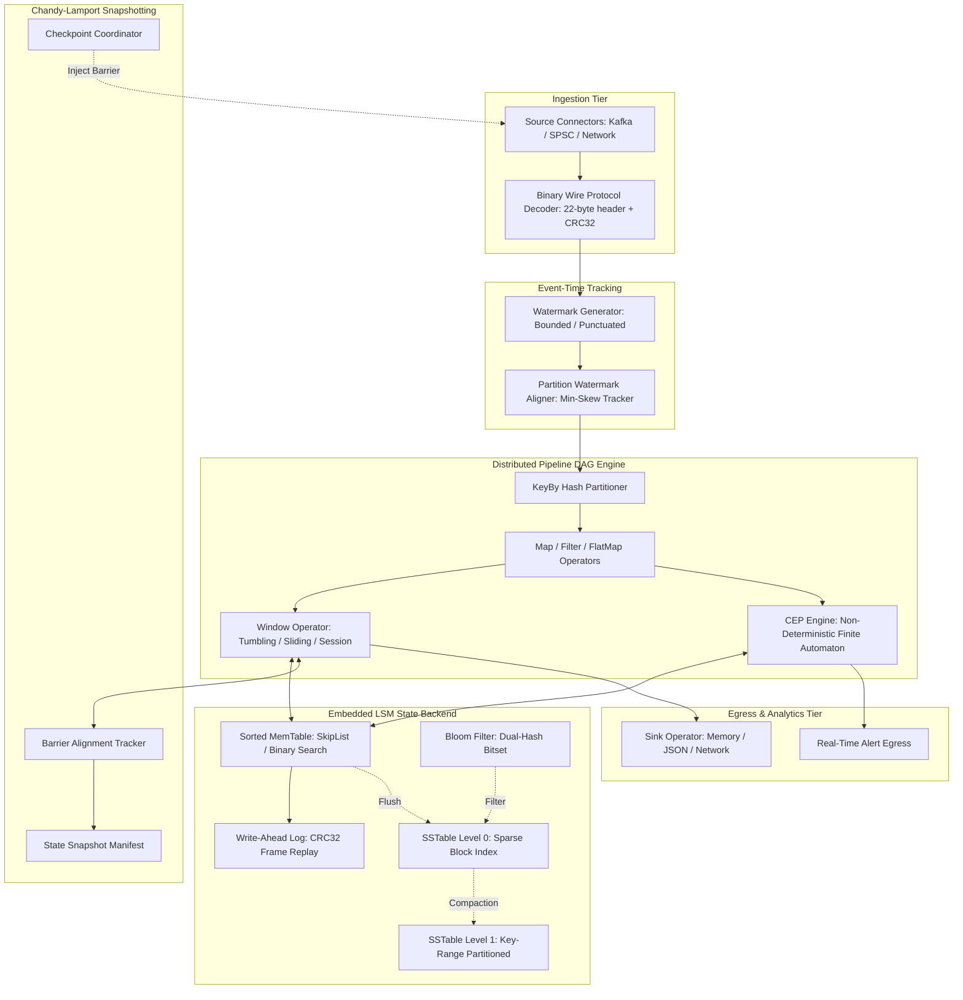

# Weir Architecture Specification

Weir is a high-throughput, low-latency distributed stateful stream processing and complex event processing (CEP) runtime implemented in MoonBit. It is designed for continuous, out-of-order event streams, combining out-of-order event-time watermarking, an embedded Log-Structured Merge (LSM) state backend, asynchronous Chandy-Lamport distributed snapshotting, and a continuous streaming SQL engine.

## Core Design Principles

1. **Zero-Allocation Dataflow**: Inner streaming loops operate on power-of-two circular ring buffers with bitwise index masking (`index & mask`), avoiding dynamic memory allocation in the critical path.
2. **Deterministic Event-Time Semantics**: System wall-clock time is decoupled from event processing. Events carry microsecond-precision timestamps, and progress is driven by monotonic watermarks that bound out-of-order latency.
3. **Log-Structured State Durability**: Operator state (such as open windows and CEP partial matches) is backed by an embedded LSM engine featuring write-ahead logging (WAL), sorted MemTables, immutable SSTables with sparse index handles, and multi-hash Bloom filters.
4. **Asynchronous Checkpointing**: Continuous streaming is snapshot via the Chandy-Lamport barrier alignment protocol. Checkpoint barriers flow inline with data records, creating globally consistent checkpoints without stopping pipeline execution.
5. **Declarative Stream Relational Algebra**: High-level streaming queries written in WeirSQL are parsed via recursive descent into Abstract Syntax Trees (ASTs) and compiled into physical streaming execution graphs.

## Subsystem Architecture

### 1. Types and Record Envelope (`types/`)
Every event passing through the runtime is encapsulated in a `StreamRecord` envelope:
- **Header**: Contains `stream_id`, `partition_id`, `sequence_number`, and `ingest_time`.
- **Payload**: Heterogeneous data variant supporting `Int`, `Double`, `String`, `Bytes`, `Array`, and nested `Map` values.
- **Control Markers**: Transparently multiplexes `DataEvent`, `WatermarkMarker`, `BarrierMarker`, `HeartbeatMarker`, and `EndOfStreamMarker`.

### 2. Lock-Free Buffers and Channels (`buffer/`)
Inter-operator communication relies on single-producer single-consumer (SPSC) ring buffers:
- Power-of-two bounded capacity guarantees fast non-blocking modulo wrapping.
- Multi-policy overflow semantics: `Block` (backpressure), `DropOldest` (lossy real-time), and `DropNewest`.
- Telemetry tracking for total pushed/popped elements, dropped records, and instantaneous channel saturation.

### 3. Event-Time Watermarking (`watermark/`)
Handles real-world network latency and out-of-order arrivals:
- **Monotonic & Bounded Generators**: Emits watermarks lagged by configurable duration `t_wm = max_event_time - bound`.
- **Partition Alignment**: In multi-channel topologies, downstream watermarks advance only to `min(channel_watermarks)`, preventing premature window firing across parallel partitions.
- **Dead-Letter Routing**: Records arriving strictly behind the active watermark are intercepted by `LateDataHandler` and routed to dead-letter side outputs.

### 4. Stateful Windowing and Accumulators (`window/`)
- Window models: [start, end) time slices for tumbling, sliding, and dynamic gap-based session windows.
- Accumulators: Zero-allocation statistical summaries (`CountAccumulator`, `SumDoubleAccumulator`, `StatsAccumulator` calculating mean, min, max, count, and associative merge).
- Triggers: Composable event-time, record-count, and delta triggers determining exact firing and state purging rules.

### 5. Embedded LSM State Backend (`state/`)
Provides durable key-value storage for stateful streaming operators:
- **Write-Ahead Log (WAL)**: Synchronous append-only log with 4-byte CRC32 integrity verification and crash recovery replay.
- **Sorted MemTable**: In-memory sorted array with `O(log N)` binary search point queries and tombstone markers.
- **Bloom Filter**: Dynamic bitset with Kirsch-Mitzenmacher dual-hashing (`h_i = h1 + i * h2`) achieving sub-1.5% false positive rates.
- **SSTables and Compaction**: Immutable disk-like files with sparse `BlockHandle` indexes and K-way merge compaction that deduplicates keys and discards tombstones.

### 6. Chandy-Lamport Fault Tolerance (`checkpoint/`)
Implements distributed snapshotting without stopping the world:
- Special `CheckpointBarrier` records are injected into sources at checkpoint intervals.
- Operators track barrier arrivals across all incoming channels.
- Records arriving on completed channels while waiting for lagging channels are buffered in post-barrier queues.
- Once all barriers align, operator state is copied into snapshot manifests and unbuffered records are processed.

### 7. Complex Event Processing Engine (`cep/`)
Evaluates temporal pattern sequences over streaming records:
- Declarative pattern sequence specification (`begin(A).followed_by(B).within(duration)`).
- Compiled into Non-Deterministic Finite Automata (NFA) graphs with conditional predicates.
- Engine tracks concurrent active partial match states with relaxed temporal contiguity.

### 8. Continuous SQL Parser and Planner (`sql/`)
Enables declarative streaming queries:
- Lexical scanner converting SQL text into structured tokens.
- Recursive descent parser building `StreamingQuery` AST nodes supporting `SELECT`, `WHERE`, `WINDOW TUMBLE`, `GROUP BY`, and `EMIT CHANGES`.
- Physical query planner compiling ASTs into executable DAG operator pipelines.

### 9. Directed Acyclic Graph Engine (`dag/`)
- Models execution topologies as directed graphs of operator nodes and channel edges.
- Performs cycle detection using Depth-First Search (DFS) and determines execution orders via Kahn's topological sort.
- Event-driven scheduler orchestrates pipeline-wide record execution.

### 10. Binary Framing and Wire Codec (`network/`)
- 22-byte binary frame header containing magic bytes (`WEIR`), version, flags, sequence numbers, and payload length.
- CRC32 verification over payload data prevents silent network transmission corruption.
- Built-in Prometheus text-format metrics exporter for cloud observability.
