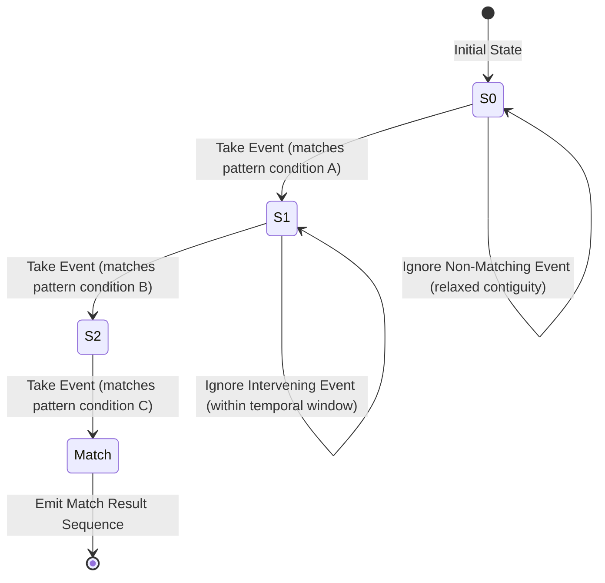

# Complex Event Processing (CEP) Automata and Pattern Matching

Weir includes a native Complex Event Processing (CEP) engine capable of detecting multi-event temporal patterns and causal relationships across out-of-order streams. The engine compiles declarative pattern sequences into Non-Deterministic Finite Automata (NFA) with support for relaxed contiguity and temporal window expiration.



## Formal Automaton Model

A pattern sequence is compiled into an NFA defined as a 5-tuple:
$$\mathcal{A} = (Q, \Sigma, \delta, q_0, F)$$
where:
- $Q = \{s_0, s_1, \dots, s_k\}$ is the finite set of automaton states.
- $\Sigma$ is the alphabet of streaming records (`StreamRecord`).
- $\delta: Q \times \Sigma \to 2^Q$ is the transition relation.
- $q_0 \in Q$ is the start state.
- $F = \{s_k\}$ is the terminal accepting state.

### Transition Actions: Take, Ignore, and Proceed
Unlike standard language recognition automata, a streaming CEP automaton operates under three transition semantics:
1. **Take**: Consumes the event, appends it to the active match trace, and advances to the successor state $s_{i+1}$.
2. **Ignore**: Skips an irrelevant event without consuming it, remaining in state $s_i$ (relaxed contiguity).
3. **Proceed**: Evaluates non-occurrence conditions (`not_followed_by`) over bounded time intervals.

## Declarative Pattern DSL

Weir provides a fluent DSL for specifying patterns:

```moonbit
let pattern = PatternSequence::new("wash_trading_detector")
  .begin("BUY_ORDER", condition_a)
  .followed_by("SELL_ORDER", condition_b)
  .within(Duration::from_seconds(5L))
```

### Contiguity Modes
- **Strict Contiguity**: The matching event must occur immediately following the previous match with no intervening events.
- **Relaxed Contiguity (`followed_by`)**: Intervening non-matching events are ignored as long as the temporal constraint `within(window)` is satisfied.
- **Non-Occurrence (`not_followed_by`)**: Asserts that no event satisfying predicate $P$ occurs within time interval $\Delta t$ following the anchor event.

## Runtime Partial Match Management

As records arrive, the `CEPEngine` evaluates all active partial matches in parallel:
1. **Branching**: When an incoming record satisfies the predicate for state $s_i$, the engine forks a new `PartialMatch` instance advancing to $s_{i+1}$ while preserving the original instance to discover concurrent overlapping patterns.
2. **Temporal Window Pruning**: Every partial match tracks its start timestamp $t_{\text{start}}$. When the current watermark advances past $t_{\text{start}} + \Delta t_{\text{max}}$, the partial match is purged from memory to bound state size.
3. **Acceptance and Materialization**: When a partial match transitions into accepting state $F$, the full trace of constituent records is emitted downstream as a complex event notification.
