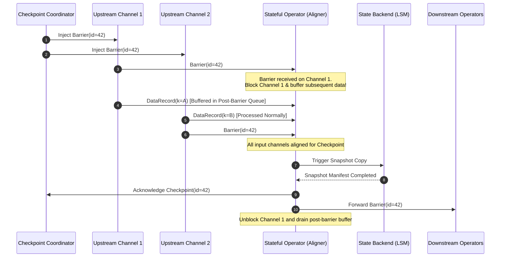

# Asynchronous Chandy-Lamport Distributed Snapshotting

Fault tolerance in continuous streaming systems cannot rely on global stop-the-world pauses. Weir implements an asynchronous variant of the Chandy-Lamport distributed snapshotting algorithm, injecting checkpoint barriers inline with streaming data to produce globally consistent state snapshots.

## The Barrier Alignment Algorithm

1. **Barrier Injection**: The master `CheckpointCoordinator` periodically increments `checkpoint_id` and injects a `CheckpointBarrier(checkpoint_id, timestamp)` marker into all source operators.
2. **Barrier Propagation**: Upstream operators broadcast the barrier downstream to all output channels alongside data records.
3. **Channel Blocking and Alignment**: When an operator receives `CheckpointBarrier(n)` on input channel $C_i$:
   - It pauses processing data from $C_i$ and stores subsequent records in a channel-specific post-barrier buffer.
   - It continues processing records from all remaining channels $C_j$ ($j \ne i$) that have not yet delivered barrier $n$.
4. **Snapshot Trigger**: Once barrier $n$ has arrived across all input channels:
   - The operator's state backend performs an atomic memory snapshot (freezing active MemTable and copying state manifest).
   - The operator broadcasts barrier $n$ to its downstream channels.
   - The operator resumes reading and processing records buffered in its post-barrier queues.
5. **Coordinator Acknowledgement**: Operators transmit an acknowledgement record to the coordinator. Once all operators confirm completion, the checkpoint is finalized.

## Correctness Proof: Global Snapshot Consistency

Let an execution of the streaming system be represented as a directed graph of operators $V$ and communication channels $E$.

**Definition (Consistent Cut):**
A cut $C = (V_C, E_C)$ is consistent if and only if for every message $m$:
$$\text{Receive}(m) \in C \implies \text{Send}(m) \in C$$
That is, no state snapshot includes the effect of receiving an event whose transmission occurred after the cut.

**Theorem (Weir Snapshot Consistency):**
The set of operator states captured at barrier alignment constitutes a consistent global snapshot.

*Proof:*
Let operator $O_A$ send records to operator $O_B$ across channel $e = (O_A, O_B)$.
Let $S_A$ be the state of $O_A$ snapshotted immediately before $O_A$ emits barrier $B_n$, and let $S_B$ be the state of $O_B$ snapshotted upon receiving barrier $B_n$.

Suppose for contradiction that $S_B$ reflects the receipt of record $r$ sent by $O_A$, but $S_A$ does not reflect the sending of $r$.
By the definition of $S_A$, $O_A$ sent record $r$ after emitting barrier $B_n$.
Channels satisfy First-In, First-Out (FIFO) ordering via single-producer single-consumer ring buffers.
Because $O_A$ emitted $B_n$ before $r$, the channel guarantees that $B_n$ arrives at $O_B$ strictly before $r$:
$$\tau_{\text{arrival}}(B_n) < \tau_{\text{arrival}}(r)$$
Under the alignment protocol, when $B_n$ arrives at $O_B$, channel $e$ is blocked and all subsequent records arriving prior to snapshot completion are diverted into the post-barrier buffer. Record $r$ is processed only after state $S_B$ has been materialized.
Therefore, record $r$ cannot be reflected in $S_B$, producing a contradiction.
Thus, the snapshot cut is consistent. $\blacksquare$

## Failure Recovery and State Restoration

When an operator crashes or unhandled node failures occur:
1. The coordinator aborts the current checkpoint and locates the highest successfully acknowledged checkpoint manifest $M_k$.
2. All operators rewind their read offsets in upstream sources to the offset recorded in $M_k$.
3. Stateful operators reset their internal state backends:
   - MemTables and active window accumulators are restored from the snapshot manifest.
   - The WAL is truncated back to checkpoint sequence ID $k$.
4. Stream processing resumes with exactly-once processing guarantees.
