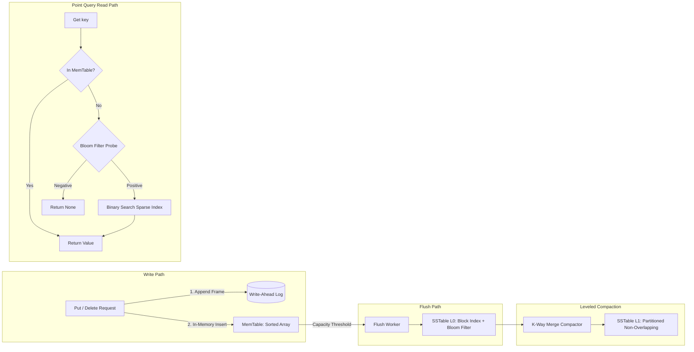

# Embedded Log-Structured Merge (LSM) State Backend

Stateful stream processing engines require high-throughput key-value storage capable of sustaining millions of mutations per second while serving point queries and supporting consistent snapshots. Weir embeds an LSM-tree storage engine optimized for memory safety and zero external database dependencies.



## Write Path and WAL Framing

All write operations (`put` and `delete`) execute synchronously against two components:
1. **Append-Only Write-Ahead Log (WAL)**: Ensures crash durability.
2. **In-Memory MemTable**: Provides sub-microsecond point lookup and ordered key iteration.

### WAL Frame Binary Layout
Every mutation in the WAL is serialized as a self-delimiting frame with CRC32 integrity verification:

```
+---------------+-------------------+---------------+---------------+
| Magic (2B)    | OpType (1B)       | KeyLen (2B)   | ValLen (4B)   |
+---------------+-------------------+---------------+---------------+
| Key Bytes (variable)              | Value Bytes (variable)        |
+-----------------------------------+-------------------------------+
| CRC32 Checksum (4B)                                               |
+-------------------------------------------------------------------+
```

During crash recovery, `WALLog::replay()` scans the log sequentially, recomputes CRC32 checksums over the payload bytes, and discards partial or corrupted trailing frames to guarantee point-in-time recovery.

## In-Memory MemTable Architecture

The MemTable maintains active mutations in a sorted key sequence:
- **Binary Search Index**: Point lookups take $O(\log N)$ comparisons via `bisect_left`.
- **Tombstone Markers**: Deletions do not immediately remove entries; they write a tombstone record with `is_tombstone = true`, ensuring deletions shadow older versions stored in on-disk SSTables.
- **Threshold Flush**: When MemTable entries exceed `max_memtable_entries`, the active MemTable is frozen and flushed to Level 0 as an immutable SSTable.

## Bloom Filter Mathematics

To avoid costly disk probes for nonexistent keys, each SSTable is paired with a Bloom filter:
- Given $n$ expected keys and target false positive probability $p \le 0.01$ (1%):
  $$m = -\frac{n \ln p}{(\ln 2)^2} \approx 9.58 \times n \text{ bits}$$
  $$k = \frac{m}{n} \ln 2 \approx 0.693 \times \frac{m}{n} \approx 4 \text{ hash functions}$$

Weir implements the Kirsch-Mitzenmacher optimization, deriving $k$ independent hash positions from two 32-bit hash components ($h_1, h_2$):
$$g_i(x) = (h_1(x) + i \cdot h_2(x)) \pmod m, \quad i \in \{0, \dots, k - 1\}$$
This eliminates the computational overhead of evaluating multiple cryptographic hash functions while preserving identical collision probabilities.

## SSTable Sparse Block Indexing

An SSTable is an immutable sequence of sorted key-value pairs organized into blocks:
- **Data Blocks**: Chunks of sorted key-value pairs (typically 4 KB each).
- **Sparse Block Index**: Stores the first key of each block along with its file offset (`BlockHandle`), keeping memory overhead proportional to $N / B$ rather than $N$.
- **Point Query Resolution**: A query first probes the in-memory Bloom filter. If positive, it performs a binary search over the sparse block handles to locate the target block, followed by an in-block scan.

## Leveled Compaction Worker

As flushes accumulate, multiple SSTables in Level 0 have overlapping key ranges. The compaction worker runs in the background to bound read amplification:
1. Selects overlapping SSTables from Level 0 and Level 1.
2. Performs a K-way merge sort using a min-heap over the sorted streams.
3. Discards shadowed older versions of keys and purges expired tombstones.
4. Emits fresh, non-overlapping SSTables into Level 1 with updated Bloom filters.
