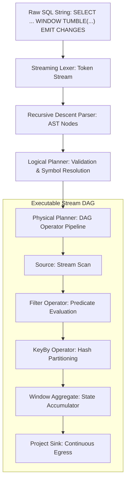

# WeirSQL Continuous Query Grammar and Execution Planning

WeirSQL provides a declarative streaming query language modeled after ANSI SQL extensions for stream-table duality. Queries operate over continuous unbounded data streams and emit incremental updates using event-time tumbling and sliding windows.



## Formal EBNF Grammar

The streaming grammar is defined formally in Extended Backus-Naur Form (EBNF):

```ebnf
StreamingQuery ::= "SELECT" SelectList
                   "FROM" Identifier
                   [ "WINDOW" WindowClause ]
                   [ "WHERE" Expression ]
                   [ "GROUP" "BY" IdentifierList ]
                   [ "EMIT" "CHANGES" ] ;

SelectList     ::= SelectItem { "," SelectItem } ;
SelectItem     ::= Expression [ [ "AS" ] Identifier ] ;

WindowClause   ::= "TUMBLE" "(" Identifier "," IntervalSpec ")"
                 | "HOP" "(" Identifier "," IntervalSpec "," IntervalSpec ")" ;

IntervalSpec   ::= "INTERVAL" Integer TimeUnit ;
TimeUnit       ::= "SECOND" | "SECONDS" | "MINUTE" | "MINUTES" | "HOUR" | "HOURS" ;

Expression     ::= LogicalOr ;
LogicalOr      ::= LogicalAnd { "OR" LogicalAnd } ;
LogicalAnd     ::= Equality { "AND" Equality } ;
Equality       ::= Relational [ ( "=" | "!=" | "<>" ) Relational ] ;
Relational     ::= Additive [ ( "<" | "<=" | ">" | ">=" ) Additive ] ;
Additive       ::= Multiplicative [ ( "+" | "-" ) Multiplicative ] ;
Multiplicative ::= Primary [ ( "*" | "/" ) Primary ] ;
Primary        ::= Identifier | Literal | "(" Expression ")" ;
```

## AST Representation and Plan Lowering

The parser converts the token sequence into a `StreamingQuery` AST containing:
- `select_fields`: List of projection expressions and output column aliases.
- `from_source`: Target streaming topic or table name.
- `window`: Optional `WindowSpec` specifying tumbling or sliding duration intervals.
- `where_clause`: Expression tree evaluated per-event before state aggregation.
- `group_by_keys`: Partitioning attributes used for hash routing across parallel operator instances.

### Lowering to Physical Operator Pipelines
The physical planner performs lowering through algebraic translation rules:
1. **Source Translation**: Resolves `from_source` into an input channel connector.
2. **Filter Pushdown**: Evaluates `where_clause` immediately following ingestion, discarding non-qualifying events prior to cross-network repartitioning.
3. **Partition Routing**: If `group_by_keys` are present, binds a `KeyByOperator` that hashes keys across parallel downstream workers.
4. **Stateful Window Aggregation**: Maps `WINDOW TUMBLE` specifications into stateful `WindowOperator` instances backed by the LSM state engine.
5. **Continuous Projection**: Applies output projections to emitted window results, writing out records with `EMIT CHANGES` semantics.
