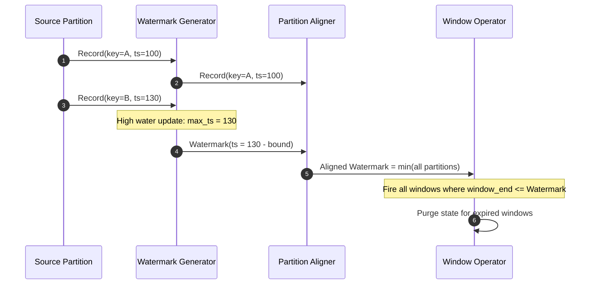

# Event-Time Watermarking and Out-of-Order Semantics

In distributed stream processing, network delays, distributed clock skews, and partition rebalancing cause events to arrive out of chronological order. Weir separates system wall-clock processing time from event-time, employing low-overhead monotonic watermarks to establish completeness guarantees for stateful operators.

## Theoretical Foundations

A stream $S$ is an infinite sequence of records:
$$S = \langle (e_1, t_1), (e_2, t_2), \dots, (e_n, t_n) \rangle$$
where each event $e_i$ is tagged with an event timestamp $t_i \in \mathbb{R}^+$ generated at the event origin (e.g., GPS sensor, order entry gateway).

In the physical runtime, records arrive at an operator at processing times:
$$\tau_1 \le \tau_2 \le \dots \le \tau_n$$
Because of network latency jitter $\delta_i$, it is common for $t_i > t_j$ when $\tau_i < \tau_j$.

### Definition: Monotonic Watermark
A watermark $W(t)$ is a monotonic control signal embedded into the stream asserting that no subsequent records with event timestamp $t' \le t$ will arrive:
$$\forall (e', t') \text{ arriving at } \tau' > \tau_{W(t)}, \quad t' > t$$

When an operator observes watermark $W(t)$, it concludes that all events belonging to windows with upper bound $w_{\text{end}} \le t$ have arrived. The operator can safely materialize the window computation and reclaim its memory state.

## Bounded Out-of-Orderness Model

Real-world event latency exhibits bounded jitter. If maximum network delay is bounded by constant $\Delta$, the generator establishes:
$$W(\tau) = \max_{i \le n(\tau)} \{t_i\} - \Delta$$

In Weir, `BoundedOutOfOrdernessGenerator` tracks the observed high-water mark with microsecond granularity:
- As new records arrive, `observed_max = max(observed_max, record.timestamp)`.
- When emitting punctuation marks, `watermark = observed_max - max_delay`.
- Monotonicity is strictly enforced: $W_{k+1} \ge W_k$. If an event arrives with timestamp less than `observed_max`, the emitted watermark never regresses.

## Multi-Partition Minimum Alignment Theorem

When an operator consumes from $M$ parallel channels $C_1, C_2, \dots, C_M$, each channel progresses at an independent rate due to source skew or load variance.

**Theorem (Partition Alignment Safety):**
Let $W_m(\tau)$ be the current watermark received on channel $C_m$. To guarantee that no window $[w_{\text{start}}, w_{\text{end}})$ fires before all upstream partitions have observed all events $t \le w_{\text{end}}$, the operator's effective watermark $W_{\text{eff}}(\tau)$ must satisfy:
$$W_{\text{eff}}(\tau) = \min_{m \in \{1, \dots, M\}} \{ W_m(\tau) \}$$

*Proof:*
Suppose for contradiction that $W_{\text{eff}}(\tau) > \min_{m} \{ W_m(\tau) \}$. Let $k = \arg\min_m \{ W_m(\tau) \}$, meaning $W_k(\tau) < W_{\text{eff}}(\tau)$.
Because channel $C_k$ is only guaranteed complete up to $W_k(\tau)$, there may exist a pending in-flight record $(e^*, t^*)$ on channel $C_k$ such that:
$$W_k(\tau) < t^* \le W_{\text{eff}}(\tau)$$
If a window $[w_{\text{start}}, w_{\text{end}})$ exists where $w_{\text{end}} = W_{\text{eff}}(\tau)$, the operator would fire and purge that window. When $(e^*, t^*)$ eventually arrives on channel $C_k$, its window is already closed and purged, resulting in data loss or incomplete aggregation.
Therefore, safety requires $W_{\text{eff}}(\tau) = \min_{m} \{ W_m(\tau) \}$. $\blacksquare$

### Handling Channel Idleness
When an upstream partition produces no data, naive minimum alignment blocks pipeline progress because its watermark remains frozen. Weir implements an idle channel timeout:
- If a channel produces no records or heartbeats within `idle_timeout`, the tracker temporarily masks that channel from the minimum calculation.
- As soon as a record arrives on the idle channel, it is automatically unmasked and integrated back into the alignment set.

## Late Data Policy and Dead-Letter Routing

When network partitions or device disconnections exceed the bounded out-of-orderness threshold $\Delta$, a record arrives with:
$$t_{\text{record}} < W_{\text{eff}}(\tau)$$

Weir provides three configurable strategies via `LateDataHandler`:
1. **Drop**: The record is silently discarded to protect state integrity, updating the `dropped_late_records` telemetry counter.
2. **Dead-Letter Side Output**: The late record is tagged and forwarded to an auxiliary `side_output` sink for post-hoc correction or audit logging.
3. **Allowed Lateness Accumulation**: Window state is retained for an additional duration $\Delta_{\text{allowed}}$. Late events trigger secondary incremental updates.
